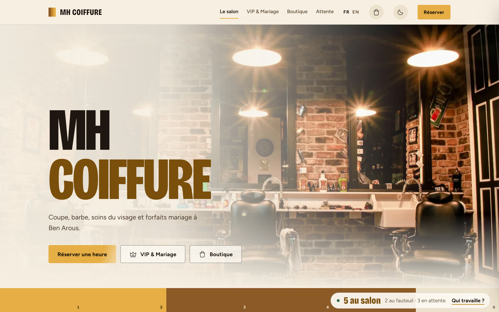
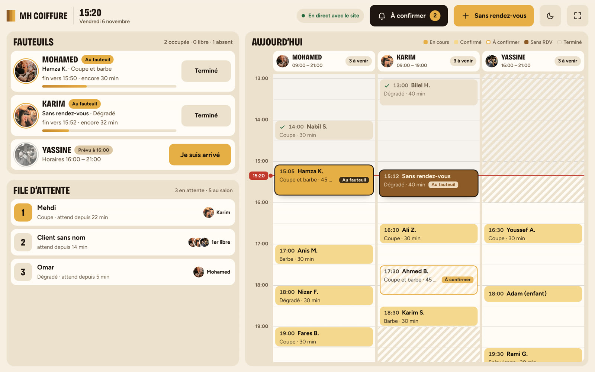
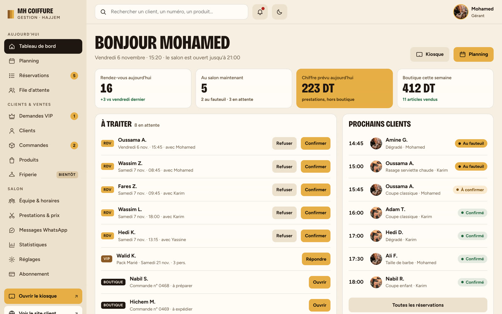

# MH Coiffure: barbershop booking

**Appointments and walk-ins in one queue, for barbershops in Tunisia.** Clients book online or check the wait, the salon tablet shows the live line, and the owner runs the shop from a dashboard.

▶ [Watch the video (MP4)](media/brag.mp4)

| Salon website | Salon tablet | Owner dashboard |
|---|---|---|
|  |  |  |

**What it does**
- Online booking that accounts for walk-ins, with a live "5 in the salon · 3 waiting" count
- A wall tablet for barbers: chairs, the waiting line and today's schedule
- Owner tools: bookings, VIP and wedding packages, the shop, stock, team hours and stats

**Built with** Next.js · TypeScript · Tailwind CSS · Supabase · WhatsApp bot

---

The source code is private. © 2026 Koussay Ben Salem. All rights reserved: see [LICENSE](LICENSE).
